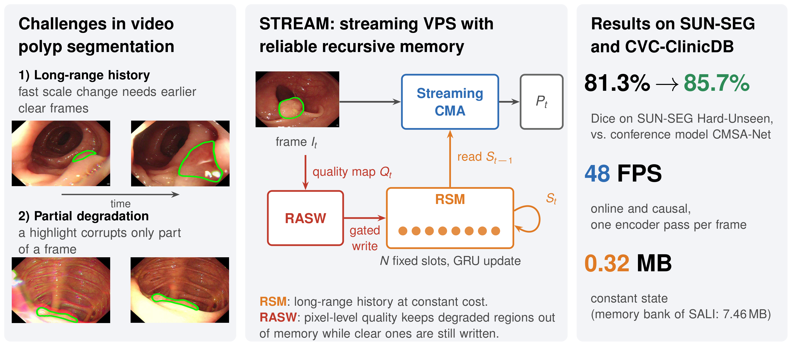
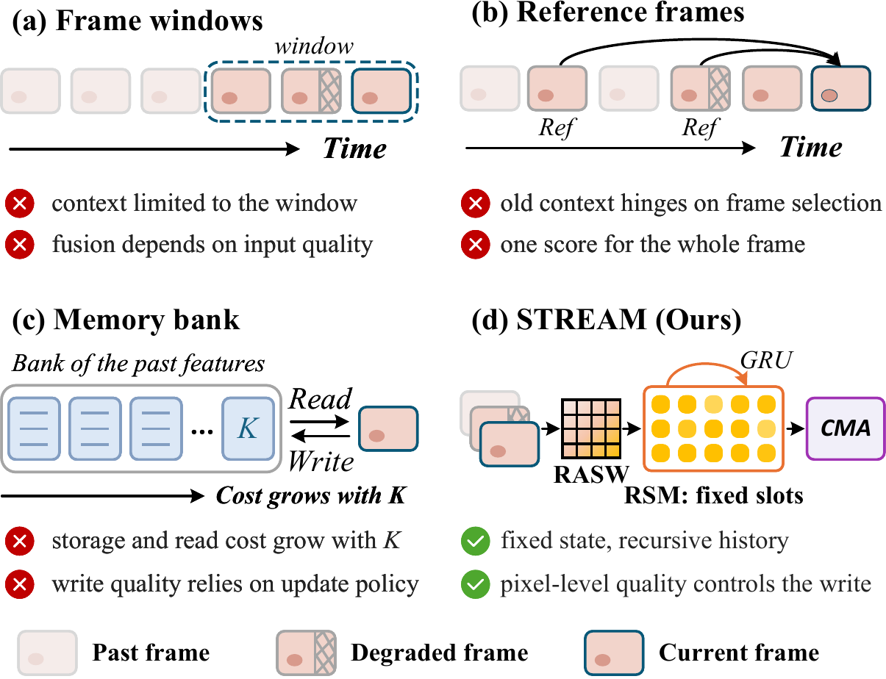
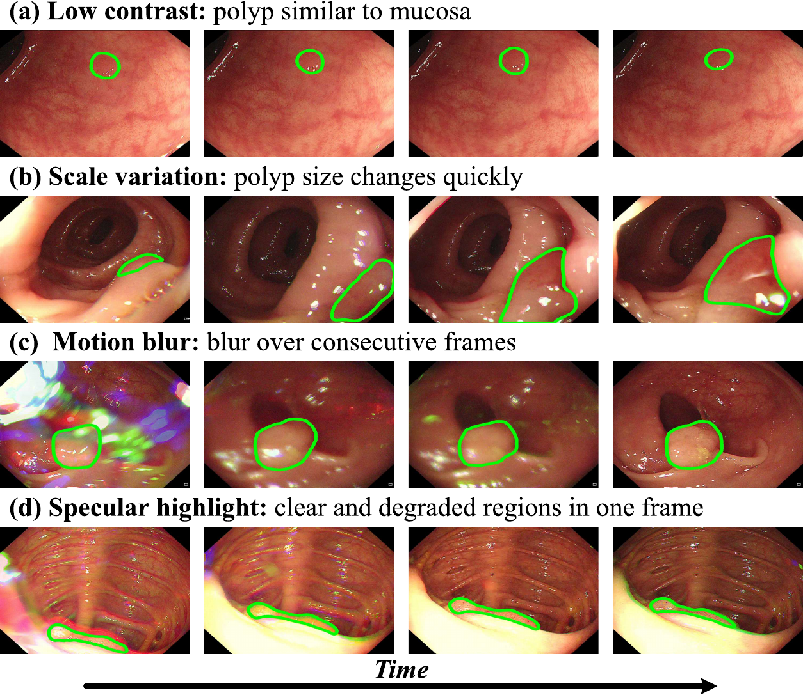
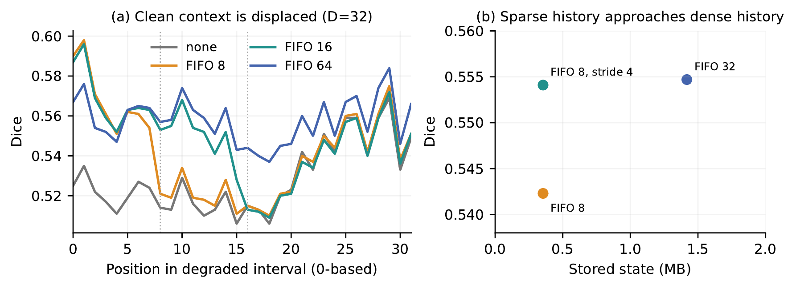
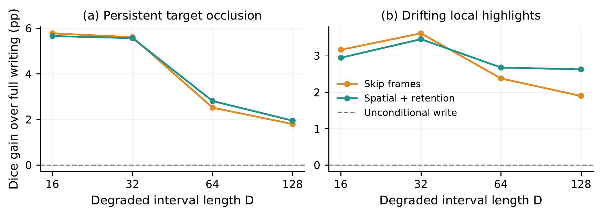
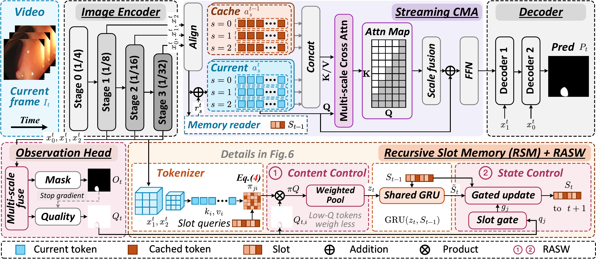
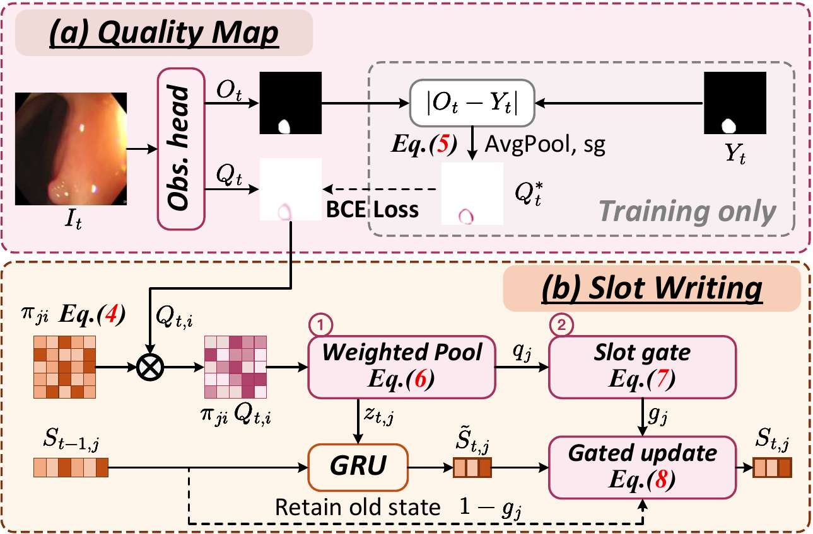
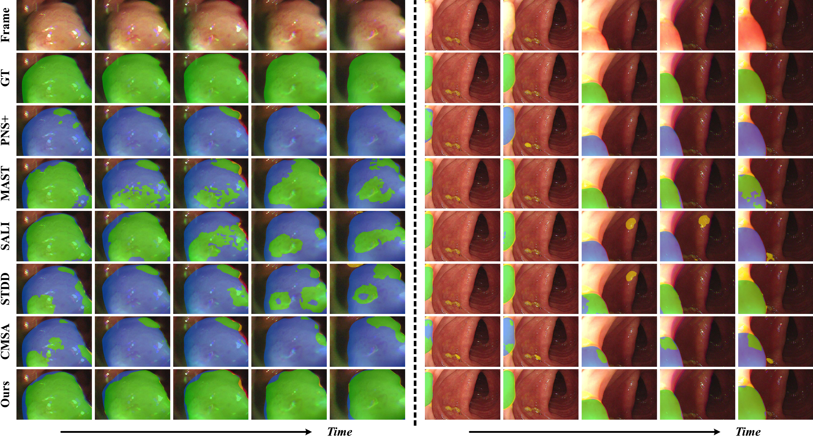
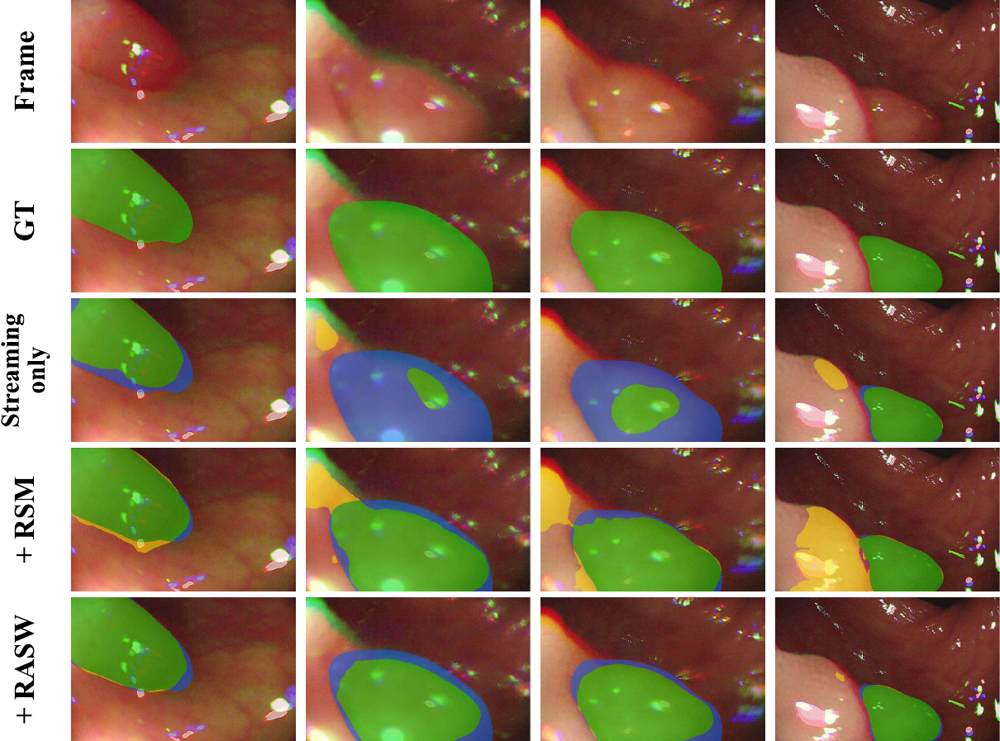

<div align="center">

# 🌊 STREAM

### Reliable Recursive Memory for Causal Multi-scale Video Polyp Segmentation

**Tong Wang<sup>1,2</sup>, Wenbo Peng<sup>1</sup>, Yaolei Qi<sup>1</sup>, Yuting He<sup>3</sup>, Yutong Xie<sup>2✉</sup>, Guanyu Yang<sup>1✉</sup>**

<sup>1</sup> Southeast University, China<br>
<sup>2</sup> Mohamed bin Zayed University of Artificial Intelligence (MBZUAI), UAE<br>
<sup>3</sup> Case Western Reserve University, USA

<sup>✉</sup> Corresponding authors. Extended version of [CMSA-Net (MICCAI 2026)](https://github.com/wangtong627/CMSA-Net).

<p>
  <a href="https://arxiv.org/abs/2611.30568"></a>
  <a href="https://arxiv.org/pdf/2611.30568"></a>
  <a href="#-code-and-release-status"></a>
  <a href="#-code-and-release-status"></a>
  <a href="https://github.com/wangtong627/CMSA-Net"></a>
</p>

<p>
  <a href="#-overview">Overview</a> ·
  <a href="#-method-framework">Method</a> ·
  <a href="#-experimental-results">Results</a> ·
  <a href="#-code-and-release-status">Release Status</a> ·
  <a href="#-citation">Citation</a>
</p>

</div>

<p align="center">
  
</p>

## 📢 News

- **[2026/11]** The preprint is now available on [arXiv (2611.30568)](https://arxiv.org/abs/2611.30568).
- **[2026/11]** The paper is currently under peer review. Source code and pretrained weights will be released after acceptance.

## 📌 Overview

Video polyp segmentation (VPS) localizes and tracks polyps frame by frame during colonoscopy, yet remains challenging due to **(1) long-range history dependence** (low-contrast polyps and rapid scale variations require context from much earlier clear frames) and **(2) spatially non-uniform degradation** (motion blur, specular highlights, and occlusion frequently corrupt only part of a frame).

Existing VPS methods retain history as whole frames—via short frame windows, discrete reference frames, or growing feature banks—which couples temporal coverage to memory cost and causes frame-level selection to either propagate degraded regions or discard usable clear areas.

We propose **STREAM**, an online streaming framework that extends the causal multi-scale aggregation (CMA) of [CMSA-Net](https://github.com/wangtong627/CMSA-Net) from fixed clips to arbitrary-length video streams:

- **Streaming CMA.** Runs the encoder once per frame and fuses current features with a previous-frame feature cache and a memory readout, eliminating future-frame buffering.
- **Recursive Slot Memory (RSM).** Summarizes multi-scale features and soft foreground/background cues into a fixed set of `N = 32` GRU-updated slots, providing long-range temporal context at a constant `0.32 MB` state regardless of video length.
- **Reliability-Aware Slot Writing (RASW).** Predicts a pixel-level quality map from the current observation alone (supervised by its local segmentation error) to control both *which locations* form candidate slot content and *how much* each slot is updated.

<p align="center">
  
</p>
<p align="center"><em>Comparison of temporal history paradigms in video polyp segmentation.</em></p>

## ✨ Highlights

- **Constant-cost long-range memory.** Replaces growing feature banks (`7.46 MB` in SALI) and discrete reference frames (`7.09 MB` in CMSA-Net) with a fixed `0.32 MB` recursive slot state.
- **Pixel-level write reliability.** Unlike frame-level gating, RASW preserves clear regions within partially degraded frames while suppressing corrupted areas and full-frame blur.
- **Strong unseen generalization.** Improves Dice over CMSA-Net from **80.3% → 85.0%** on SUN-SEG-Easy-Unseen, **81.3% → 85.7%** on SUN-SEG-Hard-Unseen, and **80.4% → 84.3%** on cross-dataset CVC-ClinicDB (PVTv2-B2).
- **Real-time causal inference.** Operates at **48 FPS** (PVTv2-B2) and **50 FPS** (Res2Net-50) with strictly causal frame-by-frame processing.

<details>
<summary><b>Motivating challenges and diagnostic observations (click to expand)</b></summary>

<p align="center">
  
</p>

1. **Observation 1 (Long coverage without dense storage):** Sparse history sampling approaches dense FIFO storage at one-quarter of the state, whereas oversized dense FIFO banks incur higher latency and lower accuracy.
2. **Observation 2 (Spatially selective writes and retention):** Under partial degradation (drifting highlights or persistent occlusion), spatial selection with state retention outperforms both unconditional writing and whole-frame skipping.

<p align="center">
  
  
</p>

</details>

## 🧩 Method Framework

<p align="center">
  
</p>
<p align="center"><em>Overview of STREAM: Streaming CMA (top) coupled with Recursive Slot Memory (RSM) and Reliability-Aware Slot Writing (RASW) (bottom).</em></p>

1. **Feature Extraction & Memory Readout.** Each incoming frame $I_t$ passes through the encoder once to extract three-scale features, which query the previous slot state $S_{t-1}$ via multi-head cross-attention to obtain scale-specific readouts.
2. **Streaming CMA.** Multi-scale cross-attention fuses the current memory-enhanced features with cached features from frame $t-1$, followed by scale fusion, FFN, and the multi-scale decoder to output mask $P_t$.
3. **Reliability-Aware Slot Writing (RASW).** An observation head (isolated from memory) predicts an observation mask $O_t$ and a spatial quality map $Q_t$. As illustrated below, $Q_t$ controls both **(1) spatial content pooling** into candidate slot representations and **(2) per-slot GRU acceptance gates** to produce the updated memory $S_t$.

<p align="center">
  
</p>
<p align="center"><em>Reliability-Aware Slot Writing (RASW): quality supervision from local observation error (a) and two-point slot write control (b).</em></p>

## 📊 Experimental Results

### Quantitative Comparison on SUN-SEG

All methods are retrained on the official SUN-SEG training split under the same protocol (`352 × 352`). **Bold** and <u>underlined</u> denote the best and second-best results, respectively.

#### SUN-SEG-Easy (%)

| Method | Venue | Backbone | Easy-Seen: Sα↑ | Eφ↑ | Fβ↑ | Dice↑ | IoU↑ | MAE↓ | Easy-Unseen: Sα↑ | Eφ↑ | Fβ↑ | Dice↑ | IoU↑ | MAE↓ |
| :--- | :--- | :--- | :---: | :---: | :---: | :---: | :---: | :---: | :---: | :---: | :---: | :---: | :---: | :---: |
| PraNet | MICCAI'20 | Res2Net-50 | 91.8 | 94.2 | 87.7 | 88.3 | 82.5 | 2.0 | 78.1 | 78.8 | 66.3 | 66.5 | 58.2 | 5.2 |
| ACSNet | MICCAI'20 | ResNet-34 | 92.0 | 94.2 | 87.4 | 88.2 | 82.8 | 1.7 | 77.2 | 76.6 | 63.0 | 63.8 | 56.4 | 4.6 |
| SANet | MICCAI'21 | Res2Net-50 | 91.6 | 93.3 | 86.6 | 87.2 | 82.0 | 1.8 | 75.0 | 72.8 | 59.0 | 59.3 | 52.4 | 5.2 |
| SEPNet | TCSVT'24 | PVTv2-B2 | 93.1 | 96.2 | 88.3 | 89.6 | 83.4 | 1.7 | 82.9 | 88.3 | 73.5 | 75.1 | 66.6 | 4.2 |
| PNS-Net | MICCAI'21 | Res2Net-50 | 90.6 | 91.0 | 83.6 | 84.1 | 78.3 | 2.0 | 76.7 | 74.4 | 61.6 | 61.8 | 54.5 | 4.8 |
| PNS+ | MIR'22 | Res2Net-50 | 91.7 | 92.5 | 84.8 | 85.5 | 78.7 | 2.1 | 80.6 | 79.8 | 67.6 | 67.8 | 59.1 | 4.4 |
| MAST | AIIM'25 | PVTv2-B2 | 92.5 | 96.2 | 87.8 | 89.3 | 82.7 | 1.6 | 83.2 | 89.4 | 74.9 | 77.0 | 67.4 | 3.7 |
| SALI | MICCAI'24 | PVTv2-B2 | 90.2 | 93.2 | 84.9 | 85.8 | 78.9 | 2.4 | 73.1 | 75.2 | 58.7 | 59.2 | 50.2 | 6.3 |
| SALI | MICCAI'24 | PVTv2-B5 | 90.7 | 93.7 | 85.1 | 86.2 | 79.6 | 2.2 | 77.1 | 82.1 | 64.6 | 65.6 | 56.8 | 5.5 |
| STDDNet | ICCV'25 | Res2Net-50 | 93.5 | 96.0 | 89.7 | 90.5 | 85.0 | 1.5 | 81.7 | 83.0 | 72.1 | 72.4 | 64.3 | 3.7 |
| STDDNet | ICCV'25 | PVTv2-B2 | 94.1 | 96.9 | 90.5 | 91.5 | 86.1 | 1.4 | 86.0 | 90.3 | 78.6 | 80.1 | 72.4 | 3.4 |
| CMSA-Net | MICCAI'26 | Res2Net-50 | 94.5 | 97.3 | 90.5 | 91.9 | 86.5 | 1.2 | 84.4 | 90.1 | 75.3 | 77.5 | 69.2 | 3.5 |
| CMSA-Net | MICCAI'26 | PVTv2-B2 | **95.1** | <u>97.5</u> | <u>91.6</u> | <u>92.6</u> | <u>87.6</u> | <u>1.1</u> | 86.7 | 90.3 | 79.3 | 80.3 | 72.6 | 2.9 |
| **STREAM (Ours)** | Preprint | Res2Net-50 | <u>94.6</u> | 97.4 | 91.1 | 92.4 | 87.1 | 1.2 | <u>88.6</u> | <u>92.4</u> | <u>81.8</u> | <u>83.8</u> | <u>76.8</u> | <u>2.5</u> |
| **STREAM (Ours)** | Preprint | PVTv2-B2 | **95.1** | **97.6** | **91.9** | **92.9** | **88.0** | **1.0** | **89.4** | **93.7** | **83.6** | **85.0** | **78.1** | **2.2** |

#### SUN-SEG-Hard (%)

| Method | Venue | Backbone | Hard-Seen: Sα↑ | Eφ↑ | Fβ↑ | Dice↑ | IoU↑ | MAE↓ | Hard-Unseen: Sα↑ | Eφ↑ | Fβ↑ | Dice↑ | IoU↑ | MAE↓ |
| :--- | :--- | :--- | :---: | :---: | :---: | :---: | :---: | :---: | :---: | :---: | :---: | :---: | :---: | :---: |
| PraNet | MICCAI'20 | Res2Net-50 | 88.4 | 91.9 | 83.1 | 83.9 | 76.6 | 3.1 | 78.7 | 80.2 | 66.7 | 67.5 | 58.7 | 5.3 |
| ACSNet | MICCAI'20 | ResNet-34 | 87.2 | 91.0 | 80.6 | 82.0 | 74.8 | 3.6 | 76.2 | 77.6 | 61.0 | 62.4 | 54.7 | 5.3 |
| SANet | MICCAI'21 | Res2Net-50 | 87.4 | 90.5 | 81.0 | 82.0 | 74.8 | 3.3 | 75.3 | 73.6 | 59.0 | 59.5 | 52.7 | 5.5 |
| SEPNet | TCSVT'24 | PVTv2-B2 | 89.4 | 94.0 | 83.5 | 85.7 | 77.6 | 3.4 | 84.7 | 89.5 | 74.5 | 77.4 | 68.4 | 3.9 |
| PNS-Net | MICCAI'21 | Res2Net-50 | 87.0 | 89.2 | 78.7 | 79.6 | 72.1 | 3.3 | 76.7 | 75.5 | 60.9 | 61.5 | 53.9 | 5.0 |
| PNS+ | MIR'22 | Res2Net-50 | 88.7 | 90.2 | 80.6 | 81.3 | 72.8 | 3.0 | 79.8 | 79.3 | 65.4 | 66.1 | 57.1 | 5.0 |
| MAST | AIIM'25 | PVTv2-B2 | 89.2 | 94.2 | 83.2 | 85.3 | 76.7 | 2.6 | 85.6 | 91.3 | 77.2 | 79.9 | 70.8 | 3.1 |
| SALI | MICCAI'24 | PVTv2-B2 | 86.8 | 90.9 | 79.9 | 81.0 | 72.6 | 3.4 | 72.8 | 75.9 | 56.9 | 57.9 | 48.7 | 6.8 |
| SALI | MICCAI'24 | PVTv2-B5 | 86.6 | 91.0 | 79.7 | 81.0 | 72.9 | 3.8 | 76.5 | 81.3 | 62.0 | 63.6 | 54.7 | 5.7 |
| STDDNet | ICCV'25 | Res2Net-50 | 91.3 | 95.2 | 86.9 | 88.1 | 81.0 | 2.3 | 83.4 | 85.6 | 74.1 | 75.0 | 67.3 | 3.7 |
| STDDNet | ICCV'25 | PVTv2-B2 | 91.1 | 95.0 | 86.0 | 87.8 | 80.6 | 2.8 | 86.3 | 90.2 | 78.1 | 80.2 | 72.2 | 3.5 |
| CMSA-Net | MICCAI'26 | Res2Net-50 | 92.7 | 96.1 | 87.1 | 89.8 | 83.0 | 1.8 | 85.1 | 89.8 | 75.0 | 78.0 | 69.5 | 3.6 |
| CMSA-Net | MICCAI'26 | PVTv2-B2 | 92.3 | 95.6 | 87.1 | 88.9 | 82.1 | 1.9 | 87.3 | 91.0 | 79.6 | 81.3 | 73.7 | 2.9 |
| **STREAM (Ours)** | Preprint | Res2Net-50 | <u>92.9</u> | <u>96.6</u> | <u>88.3</u> | <u>90.2</u> | <u>83.4</u> | <u>1.6</u> | <u>88.7</u> | <u>93.3</u> | <u>81.5</u> | <u>84.0</u> | <u>76.5</u> | <u>2.4</u> |
| **STREAM (Ours)** | Preprint | PVTv2-B2 | **93.3** | **96.7** | **89.0** | **90.6** | **84.2** | **1.3** | **89.9** | **94.0** | **83.5** | **85.7** | **78.5** | **2.1** |

### Cross-Dataset Generalization (CVC-ClinicDB) & Efficiency

<details>
<summary><b>View CVC-ClinicDB and efficiency tables (click to expand)</b></summary>

#### Cross-dataset evaluation on CVC-ClinicDB (zero-shot from SUN-SEG)

| Method | Backbone | Sα↑ | Eφ↑ | Fβ↑ | Dice↑ | IoU↑ | MAE↓ |
| :--- | :--- | :---: | :---: | :---: | :---: | :---: | :---: |
| PraNet | Res2Net-50 | 84.3 | 86.7 | 76.0 | 76.4 | 68.0 | 3.9 |
| SEPNet | PVTv2-B2 | 85.2 | 88.1 | 77.6 | 77.4 | 69.9 | 3.8 |
| STDDNet | Res2Net-50 | 87.0 | 88.8 | 80.3 | 80.4 | 72.5 | 3.2 |
| STDDNet | PVTv2-B2 | 88.7 | <u>91.8</u> | 83.7 | 83.7 | 75.7 | <u>2.8</u> |
| CMSA-Net | Res2Net-50 | 82.6 | 83.4 | 74.1 | 73.4 | 65.1 | 4.4 |
| CMSA-Net | PVTv2-B2 | 87.2 | 89.0 | 80.1 | 80.4 | 72.1 | 3.4 |
| **STREAM (Ours)** | Res2Net-50 | **89.7** | **93.5** | **85.1** | **86.1** | **78.5** | **2.6** |
| **STREAM (Ours)** | PVTv2-B2 | <u>89.0</u> | <u>91.8</u> | <u>83.8</u> | <u>84.3</u> | <u>76.4</u> | <u>2.8</u> |

#### Efficiency comparison over 6 frames at 352 × 352

| Method | Backbone | GFLOPs↓ | Param. (M)↓ | FPS↑ | State (MB)↓ |
| :--- | :--- | :---: | :---: | :---: | :---: |
| PraNet | Res2Net-50 | 78.89 | 30.50 | 42 | N/A |
| ACSNet | ResNet-34 | 130.52 | 29.45 | 21 | N/A |
| SALI | PVTv2-B2 | 86.58 | 82.73 | 10 | 7.46 |
| STDDNet | Res2Net-50 | 75.17 | 38.16 | 45 | 7.09 |
| STDDNet | PVTv2-B2 | 64.18 | 29.67 | 36 | 7.09 |
| CMSA-Net | Res2Net-50 | 73.36 | 29.61 | 47 | 7.09 |
| CMSA-Net | PVTv2-B2 | 59.42 | 25.79 | 38 | 7.09 |
| **STREAM (Ours)** | Res2Net-50 | 73.73 | 29.68 | **50** | **0.32** |
| **STREAM (Ours)** | PVTv2-B2 | 59.84 | 25.88 | 48 | **0.32** |

</details>

### Qualitative Comparison

<p align="center">
  
</p>
<p align="center"><em>Qualitative comparison on SUN-SEG-Hard-Unseen under consecutive blur/highlights (left) and large scale changes (right). Green: TP; yellow: FP; blue: FN.</em></p>

<p align="center">
  
</p>
<p align="center"><em>Visual ablation on a clip with blurred frames: RSM restores missed polyps, and RASW suppresses false positives carried from degraded frames.</em></p>

## 📦 Code and Release Status

> [!NOTE]
> **The manuscript is currently under peer review.** To respect the review process, source code and pretrained model weights are not publicly released at this stage and will be made available upon acceptance.

- [x] Preprint released on [arXiv](https://arxiv.org/abs/2611.30568)
- [x] Repository overview, architecture figures, and benchmark results
- [ ] Training, streaming inference, and evaluation code
- [ ] Pretrained model weights (Res2Net-50 & PVTv2-B2) and prediction maps

## 📖 Citation

If you find STREAM useful in your research, please consider citing our paper and conference work:

```bibtex
@article{wang2026stream,
  title={Reliable Recursive Memory for Causal Multi-scale Video Polyp Segmentation},
  author={Wang, Tong and Peng, Wenbo and Qi, Yaolei and He, Yuting and Xie, Yutong and Yang, Guanyu},
  journal={arXiv preprint arXiv:2611.30568},
  year={2026},
  url={https://arxiv.org/abs/2611.30568}
}
```

## 🔗 Related Projects

- [CMSA-Net (MICCAI 2026)](https://github.com/wangtong627/CMSA-Net): Causal multi-scale aggregation with adaptive multi-source reference for video polyp segmentation.
- [ARTEMIS](https://github.com/wangtong627/ARTEMIS): Agent-guided reliability-aware temporal mask evolution for imperfectly supervised video polyp segmentation.
- [LAMP](https://github.com/wangtong627/LAMP): FOV-aware polyp image synthesis via lesion-guided adaptive mucosal context propagation.

## 📬 Contact

For questions about the paper or future code release, please open an [issue](https://github.com/wangtong627/STREAM/issues) or contact [tongwangnj@qq.com](mailto:tongwangnj@qq.com) / [tong.wang@mbzuai.ac.ae](mailto:tong.wang@mbzuai.ac.ae).
